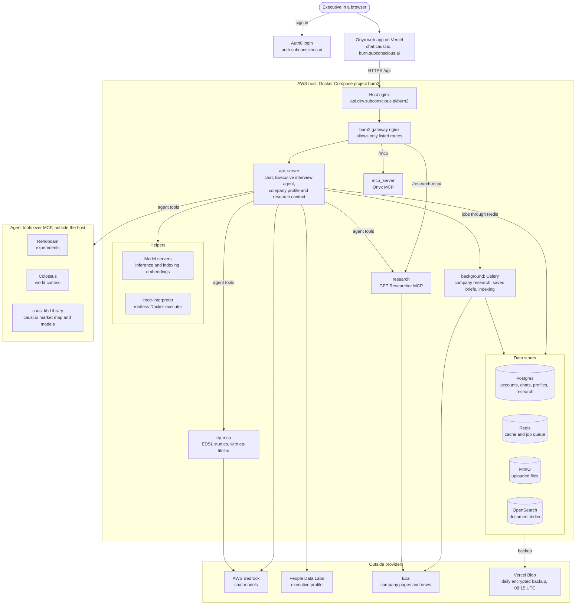

> **Subconscious Burn fork:** [Current application, architecture and recovery](docs/subconscious/README.md). Upstream Onyx documentation follows.

## Onyx chat infrastructure (Subconscious)

How a chat with the Executive interview agent reaches each service. Read from the live AWS host on 2026-11-12.



Recovery and release steps: [durable hosting](docs/subconscious/durable-hosting.md).

<a name="readme-top"></a>

<h2 align="center">
    <a href="https://www.onyx.app/?utm_source=onyx_repo&utm_medium=github&utm_campaign=readme"> </a>
</h2>

<p align="center">
    <a href="https://discord.gg/TDJ59cGV2X" target="_blank">
        
    </a>
    <a href="https://docs.onyx.app/?utm_source=onyx_repo&utm_medium=github&utm_campaign=readme" target="_blank">
        
    </a>
    <a href="https://www.onyx.app/?utm_source=onyx_repo&utm_medium=github&utm_campaign=readme" target="_blank">
        
    </a>
    <a href="https://github.com/onyx-dot-app/onyx/blob/main/LICENSE" target="_blank">
        
    </a>
</p>

<p align="center">
  <a href="https://trendshift.io/repositories/12516" target="_blank">
    
  </a>
</p>

# Onyx - The Open Source AI Platform

**[Onyx](https://www.onyx.app/?utm_source=onyx_repo&utm_medium=github&utm_campaign=readme)** is the application layer for LLMs - bringing a feature-rich interface that can be easily hosted by anyone.
Onyx enables LLMs through advanced capabilities like RAG, web search, code execution, file creation, deep research and more.

Connect your applications with over 50+ indexing based connectors provided out of the box or via MCP.

> [!TIP]
> Deploy with a single command:
> ```
> curl -fsSL https://onyx.app/install_onyx.sh | bash
> ```


---

## ⭐ Features

- **🔍 Agentic RAG:** Get best in class search and answer quality based on hybrid index + AI Agents for information retrieval
  - Benchmark to release soon!
- **🔬 Deep Research:** Get in depth reports with a multi-step research flow.
  - Top of [leaderboard](https://github.com/onyx-dot-app/onyx_deep_research_bench) as of Feb 2026.
- **🤖 Custom Agents:** Build AI Agents with unique instructions, knowledge, and actions.
- **🌍 Web Search:** Browse the web to get up to date information.
  - Supports Serper, Google PSE, Brave, SearXNG, and others.
  - Comes with an in house web crawler and support for Firecrawl/Exa.
- **📄 Artifacts:** Generate documents, graphics, and other downloadable artifacts.
- **▶️ Actions & MCP:** Let Onyx agents interact with external applications, comes with flexible Auth options.
- **💻 Code Execution:** Execute code in a sandbox to analyze data, render graphs, or modify files.
- **🎙️ Voice Mode:** Chat with Onyx via text-to-speech and speech-to-text.
- **🎨 Image Generation:** Generate images based on user prompts.

Onyx supports all major LLM providers, both self-hosted (like Ollama, LiteLLM, vLLM, etc.) and proprietary (like Anthropic, OpenAI, Gemini, etc.).

To learn more - check out our [docs](https://docs.onyx.app/welcome?utm_source=onyx_repo&utm_medium=github&utm_campaign=readme)!

---

## 🚀 Deployment Modes

> Onyx supports deployments in Docker, Kubernetes, Helm/Terraform and provides guides for major cloud providers.
> Detailed deployment guides found [here](https://docs.onyx.app/deployment/overview).

Onyx supports two separate deployment options: standard and lite.

#### Onyx Lite

The Lite mode can be thought of as a lightweight Chat UI. It requires less resources (under 1GB memory) and runs a less complex stack.
It is great for users who want to test out Onyx quickly or for teams who are only interested in the Chat UI and Agents functionalities.

#### Standard Onyx

The complete feature set of Onyx which is recommended for serious users and larger teams. Additional components not included in Lite mode:
- Vector + Keyword index for RAG.
- Background containers to run job queues and workers for syncing knowledge from connectors.
- AI model inference servers to run deep learning models used during indexing and inference.
- Performance optimizations for large scale use via in memory cache (Redis) and blob store (MinIO).

> [!TIP]  
> **To try Onyx for free without deploying, visit [Onyx Cloud](https://cloud.onyx.app/signup?utm_source=onyx_repo&utm_medium=github&utm_campaign=readme)**.

---

## 🏢 Onyx for Enterprise

Onyx is built for teams of all sizes, from individual users to the largest global enterprises:
- 👥 Collaboration: Share chats and agents with other members of your organization.
- 🔐 Single Sign On: SSO via Google OAuth, OIDC, or SAML. Group syncing and user provisioning via SCIM.
- 🛡️ Role Based Access Control: RBAC for sensitive resources like access to agents, actions, etc.
- 📊 Analytics: Usage graphs broken down by teams, LLMs, or agents.
- 🕵️ Query History: Audit usage to ensure safe adoption of AI in your organization.
- 💻 Custom code: Run custom code to remove PII, reject sensitive queries, or to run custom analysis.
- 🎨 Whitelabeling: Customize the look and feel of Onyx with custom naming, icons, banners, and more.

## 📚 Licensing

There are two editions of Onyx:

- Onyx Community Edition (CE) is available freely under the MIT license and covers all of the core features for Chat, RAG, Agents, and Actions.
- Onyx Enterprise Edition (EE) includes extra features that are primarily useful for larger organizations.

For feature details, check out [our website](https://www.onyx.app/pricing?utm_source=onyx_repo&utm_medium=github&utm_campaign=readme).

## 👪 Community

Join our open source community on **[Discord](https://discord.gg/TDJ59cGV2X)**!

## 💡 Contributing

Looking to contribute? Please check out the [Contribution Guide](CONTRIBUTING.md) for more details.
